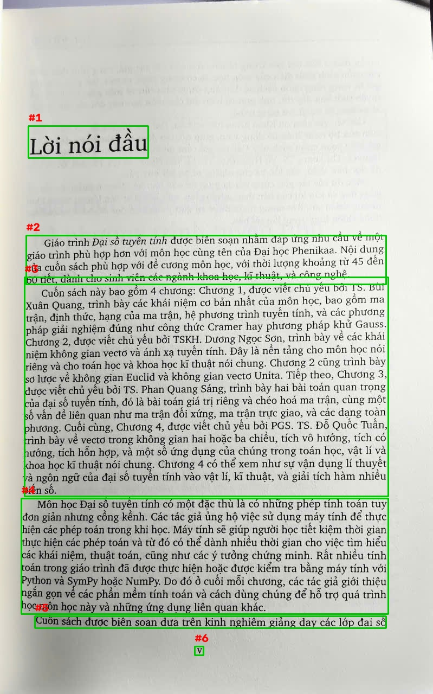

# Hệ Thống Trích Xuất Văn Bản Tiếng Việt (YOLOv8-DocLayNet + EasyOCR)

Dự án tự động phát hiện bố cục trang tài liệu, sắp xếp thứ tự đọc tự nhiên và trích xuất văn bản tiếng Việt từ hình ảnh.

## 🔄 Quy trình xử lý (4 Bước)
1. **Phát hiện vùng bố cục:** Sử dụng mô hình `YOLOv8n-DocLayNet` để khoanh vùng chính xác các khối văn bản.
2. **Sắp xếp thứ tự đọc:** Sắp xếp tọa độ khung tăng dần theo trục dọc (`y1`) để giữ đúng mạch đọc từ trên xuống dưới.
3. **Cắt vùng ảnh:** Cắt rời từng khối văn bản kèm khoảng đệm an toàn (`PADDING`).
4. **Nhận dạng tiếng Việt:** Dùng `EasyOCR` (`lang=['vi']`) trích xuất chữ và xuất kết quả ra file `ket_qua_van_ban.txt` cùng ảnh minh họa `anh_nhan_dien.jpg`.

## 🖼️ Minh họa kết quả
# tai-lieu-01
